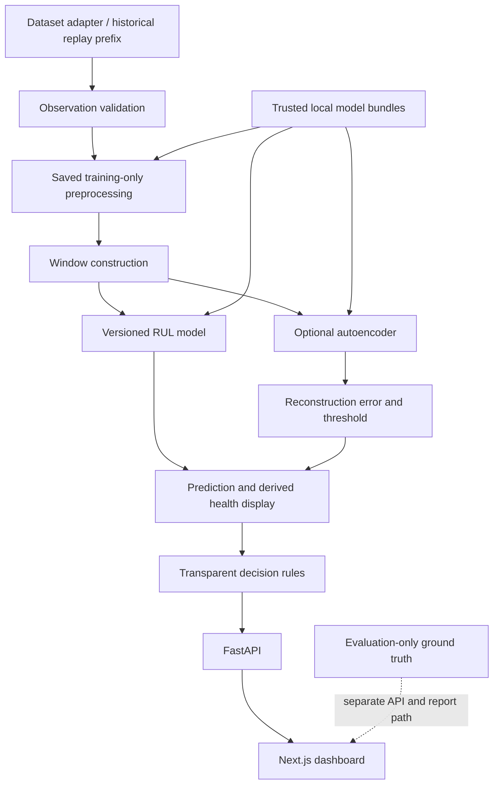

# NeuroPulse — Neural Predictive Maintenance System

**Project title:** Neural Predictive Maintenance System: An Experimental Framework for Machine Degradation Modeling, Anomaly Detection, and Remaining Useful Life Prediction.

**Blueprint version:** 1.0 · **Prepared:** 2026-10-13 · **Status update:** 2026-10-20. FD001 core research, local replay, and the container demonstration are implemented; source traceability of the original unversioned research suite and hosted CI remain open. See [implementation progress](docs/progress.md) for evidence.

This root document is the source of truth for implementation. Its intended readers are coding agents, ML engineers, academic reviewers, and maintainers. The original blueprint deliverable was this document only; on 2026-10-13 the user authorized staged scaffolding. Proposed paths, commands, and interfaces below remain specifications unless the progress log records implementation and validation evidence. Do not interpret staged authorization as a request to execute every milestone at once.

## Contents

1. [Project Identity and Mission](#1-project-identity-and-mission)
2. [Problem Statement](#2-problem-statement)
3. [Academic Motivation](#3-academic-motivation)
4. [Research Questions](#4-research-questions)
5. [Scope and Success Criteria](#5-scope-and-success-criteria)
6. [System Capabilities](#6-system-capabilities)
7. [Dataset Strategy](#7-dataset-strategy)
8. [Mathematical Foundations](#8-mathematical-foundations)
9. [Custom Neural Computation Engine](#9-custom-neural-computation-engine)
10. [Neural Model Architectures](#10-neural-model-architectures)
11. [Experimental Methodology](#11-experimental-methodology)
12. [Evaluation Metrics](#12-evaluation-metrics)
13. [Integrated System Architecture](#13-integrated-system-architecture)
14. [Technology Stack](#14-technology-stack)
15. [Repository Structure](#15-repository-structure)
16. [Data Contracts and Model Interfaces](#16-data-contracts-and-model-interfaces)
17. [Detailed Implementation Roadmap](#17-detailed-implementation-roadmap)
18. [MVP, Full Scope, and Stretch Goals](#18-mvp-full-scope-and-stretch-goals)
19. [Backend Architecture](#19-backend-architecture)
20. [Frontend Architecture](#20-frontend-architecture)
21. [Historical Replay Design](#21-historical-replay-design)
22. [Maintenance Decision Engine](#22-maintenance-decision-engine)
23. [Testing and Validation](#23-testing-and-validation)
24. [Reproducibility Requirements](#24-reproducibility-requirements)
25. [Research Literature and Citation Plan](#25-research-literature-and-citation-plan)
26. [Risks and Mitigations](#26-risks-and-mitigations)
27. [Development Conventions](#27-development-conventions)
28. [Agent Execution Instructions](#28-agent-execution-instructions)
29. [Milestone Acceptance Criteria](#29-milestone-acceptance-criteria)
30. [Definition of Done](#30-definition-of-done)

## 1. Project Identity and Mission

NeuroPulse investigates how neural computation learns representations of machine degradation. Deliver an independently validated NumPy neural engine, a reproducible PyTorch experimental framework, and an application that demonstrates the resulting models through chronological historical replay.

Neural computation is the intellectual centerpiece. Every implemented custom operation must have a documented forward equation, backward derivation, shape contract, and correctness evidence. Research results must connect architecture and optimization choices to measured behavior; a dashboard alone is insufficient.

Use the existing `D:\GitHub\1_Projects\NeuroPulse` directory. At blueprint preparation it was empty, without a Git repository; Phase 1 initializes local Git. CPU-first execution is confirmed. The initial audit measured 12 logical processors and 16,870,006,784 bytes physical RAM; GPU availability, deadlines, and actual training runtime remain unverified. Local Python 3.12.3 versus the proposed 3.11 baseline is recorded in [decision 0001](docs/decisions/0001-stage-one-environment.md). Assume one engineer working incrementally, with optional acceleration that does not change scientific methodology.

## 2. Problem Statement

Reactive maintenance repairs equipment after failure; preventive maintenance follows a schedule; predictive maintenance uses observed condition to inform intervention. Here the benchmark task is to estimate remaining operating cycles from multivariate sensor histories. Complement it with reconstruction-based anomaly monitoring and transparent demonstration rules.

Distinguish four quantities: predicted RUL, reconstruction error, a derived visualization index, and a rule-generated recommendation. None is automatically a failure probability. The model does not recover a physical failure mechanism merely by fitting benchmark targets.

The available primary data are simulated turbofan trajectories, not measurements from a deployed factory. Replay demonstrates software behavior and prefix-only inference, not validated industrial deployment. No cycles-to-hours conversion is permitted without a documented mapping.

## 3. Academic Motivation

The contribution is a systematic experimental investigation with independently implemented and checked neural operations, reproducible comparisons, and an integrated demonstration. Do not claim invention of predictive maintenance, MLPs, CNNs, LSTMs, hybrids, or autoencoders.

Defend the contribution through derivations, numerical checks, NumPy/PyTorch parity, controlled ablations, consistent partitions, per-engine error analysis, and explicit negative results. Published scores are context, not directly comparable evidence unless their target policy, split, padding, feature set, and evaluation population match ours.

## 4. Research Questions

| Question | Concrete experiment | Data and models | Metrics and deliverables |
|---|---|---|---|
| RQ1: architecture | Compare matched pipelines and tuning budgets | FD001 first; MLP, CNN, LSTM, CNN-LSTM plus regression controls | Terminal MAE/RMSE/NASA score, paired engine errors, parameter counts, architecture table |
| RQ2: history | Windows 10, 30, 50, 100; hold other settings fixed | FD001 MLP and LSTM first, all neural regressors in full scope | Terminal and stage metrics, short-trajectory padding counts, common-engine sensitivity plot |
| RQ3: optimization | One-factor studies of depth, width, activation, initialization, optimizer | NumPy/PyTorch MLP; selected LSTM optimizer study | Learning curves, gradient norms, convergence failures, validation error, elapsed time |
| RQ4: anomaly | Healthy-proxy AE training and threshold sensitivity | FD001 dense AE; secondary labeled faults only as stretch | Reconstruction distributions, proxy false alarms; classification/lead-time metrics only with stated label basis |
| RQ5: combined decisions | RUL-only, anomaly-only, combined rules at matched alert budgets | Held-out training engines; optional cross-fitted anomaly-informed regressor | First warning cycle, pre-failure warning lead, alert frequency, assumed cost; no assumed improvement |
| RQ6: robustness | Sensor noise first; subset/condition tests later | FD001 noise; FD002–FD004 separate models; explicit cross-subset transfer as stretch | Error increase, false-alert change, latency, per-condition errors, applicability limits |

RQ1–RQ3 form the core research. RQ4–RQ5 require full-scope models; RQ6 begins with a feasible noise study and expands only when compute and preprocessing are ready. A paper-to-experiment matrix in Phase 0 must record what is reproduced, changed, or intentionally omitted.

## 5. Scope and Success Criteria

MVP success means a leakage-safe FD001 pipeline, checked custom MLP, measured baselines and PyTorch MLP/LSTM, repeatable runs, official terminal evaluation, and working replay/API/dashboard integration. Neural models need not outperform baselines for completion; poor performance must trigger diagnosis and be reported honestly.

Full academic success adds temporal comparisons, custom Conv1D, autoencoder analysis, selected optimization studies, decision-rule ablations, complete dashboard views, and a research report. Do not require the full Cartesian product of all architectures, windows, widths, optimizers, and subsets.

Exclude live industrial hardware, safety certification, automatic machine actuation, Kafka, Kubernetes, microservice decomposition, guaranteed failure probabilities, and full custom autograd from core scope. Stretch work must have its own acceptance gates.

## 6. System Capabilities

| Capability | MVP behavior | Full/advanced behavior |
|---|---|---|
| Monitoring | Inspect dataset machines and available sensor prefixes | Additional dataset adapters; live telemetry remains an extension |
| RUL | One estimate in cycles per complete historical window | Architecture selection and optional evaluated uncertainty |
| Anomaly | Explicitly unavailable/null | AE reconstruction score and validation-calibrated threshold |
| Health display | Clearly labeled RUL-derived index | Sensor/anomaly context; no unsupported physical interpretation |
| Recommendations | RUL demonstration thresholds and reason codes | Combined anomaly/RUL rules and evaluated alert behavior |
| Replay | Select engine, advance/pause/resume/reset, control speed | Multiple sessions and alert history |
| Comparisons | Read saved experiment metrics and training curves | Filters, paired comparisons, distributions and artifacts |

## 7. Dataset Strategy

### 7.1 Primary benchmark and provenance

NASA describes training trajectories ending at failure and truncated test trajectories with a separate terminal-RUL vector. Its catalog lists the following populations; these are source-reported counts, not locally measured statistics. [NASA C-MAPSS catalog](https://data.nasa.gov/dataset/cmapss-jet-engine-simulated-data)

| Subset | Train engines | Test engines | Conditions | Fault modes |
|---|---:|---:|---|---|
| FD001 | 100 | 100 | 1 | HPC degradation |
| FD002 | 260 | 259 | 6 | HPC degradation |
| FD003 | 100 | 100 | 1 | HPC and fan degradation |
| FD004 | 248 | 249 | 6 | HPC and fan degradation |

Expected schema is 26 numeric columns: engine ID, cycle, three settings, and 21 sensors. The catalog's final sensor wording is inconsistent with its total; verify the archive README and actual row widths before accepting the parser. Keep names `sensor_01`–`sensor_21` until physical mappings are verified.

Initial Phase 0 inspection found the same sensor-description typo in the archive README and verified 26 tokens on every FD001 training row (20,631 rows, 100 IDs). This supports the 21-sensor structural contract; it does not replace Phase 2 numeric/continuity/quality checks. See [dataset audit](docs/data/dataset-audit.md) for measured hashes and unresolved usage terms. No dataset was retained during that in-memory audit.

Start from the official [NASA PCoE repository](https://www.nasa.gov/intelligent-systems-division/discovery-and-systems-health/pcoe/pcoe-data-set-repository/), which links the PHM Society-hosted turbofan archive and requests attribution to repository and donors. Do not confuse the four-subset benchmark with the separately listed PHM08 challenge or N-CMAPSS. Verify download availability without silently substituting a mirror.

The NASA catalog states that a license is not specified. Public access does not establish redistribution rights. Phase 0 must record archive terms, attribution, access date, and unresolved restrictions; large raw data remain local. [Catalog usage metadata](https://data.nasa.gov/dataset/cmapss-jet-engine-simulated-data)

Acquisition manifest fields: dataset/version, publisher, landing/download URL, access date, archive and extracted-file SHA-256 hashes, original filenames, subset, schema version, source-reported counts, measured counts, usage-term evidence, and verification status. Do not download data during creation of this blueprint.

### 7.2 Parser and exploration

Parse whitespace-delimited files, ignoring trailing whitespace rather than manufacturing columns. Require integral positive IDs/cycles, exactly 26 values per row, finite numeric values, unique `(subset, partition, engine, cycle)` keys, increasing cycles, and expected unit-label alignment. Composite identity must include partition: training engine 1 and test engine 1 are different machines.

EDA must produce measured trajectory lengths, schema/count checks, missing/invalid-value counts, per-sensor distributions and variance, settings clusters, representative engine curves, correlations, and prefix availability by window length. Keep official test labels out of EDA used for model selection.

Default missing-value policy is fail-fast with a quality report. If verified data require imputation, record an amendment: training-derived medians or within-engine causal forward fill only, with missingness indicators and sensitivity analysis. Never interpolate using later observations. Do not claim expected clean benchmark files were checked before acquisition.

### 7.3 Splits, transformations, and targets

1. For each subset, sort unique official training IDs, permute with NumPy `default_rng(42)`, allocate `floor(0.8*N)` to training and the remainder to validation, and save exact IDs. Split before creating windows.
2. Keep this split fixed across model seeds 42/43/44. Official test engines are a locked final-evaluation population; neither test observations nor labels fit any transformation.
3. Training/validation raw label for engine `i` at cycle `t` is `r_i(t)=T_i-t`. Training target is `min(r_i(t),125)`. The cap is a modeling assumption; compare 100, 125, 150, and uncapped on validation only. Validation model selection uses uncapped true RUL.
4. FD001 uses sensors only as model features by default; exclude ID, cycle, total lifespan, and label. Select sensors using training variance `>1e-8` in original numeric units; save the feature mask and justify any manual adjustment. Do not hard-code a literature sensor list as a verified fact.
5. Fit per-feature population mean/std on selected training sensor rows. Replace any residual near-zero std with one and log it. Apply saved transforms unchanged to validation/test; do not clamp out-of-range standardized values.
6. For FD002/FD004, add six-cluster KMeans on training-standardized settings, with `random_state=42`, `n_init=10`. Assign validation/test rows by the saved nearest centroid and normalize sensors by training cluster. A cluster with fewer than 20 rows uses the saved global training scaler. Record counts and unseen-condition distance diagnostics. Feed three globally standardized settings alongside normalized sensors for these subsets; FD003 retains the FD001 sensor policy.
7. No normalization using an engine's entire trajectory; no centered rolling features. Optional features use only the current prefix and training-fitted parameters.

Cap125 encodes the hypothesis that early-life sensor histories may not distinguish very long remaining lifetimes reliably; it creates an early plateau and a late linear decrease. This is a supervised modeling choice, not a known physical onset at 125 cycles. Its bias is assessed using uncapped validation/official labels and the cap-sensitivity study.

### 7.4 Windows and evaluation labels

For engine prefix ending at `t`, input is rows `[t-W+1,...,t]`, target belongs to `t`, and layout is `[B,W,F]`. Default `W=30`, stride one; windows never cross engines, partitions, or subsets. Persist engine/end-cycle metadata next to every window.

Training, validation-trajectory analysis, and replay use complete windows; before `W` observations replay returns `warming_up`, without a fabricated prediction. Official test terminal evaluation requires one prediction for every engine: if its trajectory is shorter than `W`, left-repeat its earliest observation until length `W`. Apply the same terminal padding policy to validation prefixes. Mark padded predictions and report padding counts for every window study; also compare the common population of engines with adequate history.

For terminal official test prediction, truth is the supplied engine-level RUL, without clipping. When displaying earlier test-prefix truth for evaluation only, compute `official_terminal_RUL + last_observed_test_cycle - t`. It uses evaluation-only information and must never enter model input, normalization, replay control, or decision rules.

Validation selection uses one reproducibly sampled truncated prefix per validation engine: sample an integer endpoint uniformly from `max(1,ceil(0.5*T))` through `T-1`, using a separate `default_rng(142)` in sorted-engine order. Save endpoints and uncapped truths; reuse them across all architectures/windows. Fail with a documented data-quality error if an engine lacks a valid endpoint. Additional trajectory metrics cover full available windows and are labeled separately.

### 7.5 Secondary dataset

Investigate CWRU only as stretch work, for normal-versus-fault detection and optional fault classification. The university describes MATLAB vibration files, drive-end sampling at 12 kHz or 48 kHz, fan-end sampling at 12 kHz, and channel/RPM variables. [CWRU data description](https://engineering.case.edu/bearingdatacenter/download-data-file)

CWRU fault records must not be assumed to provide run-to-failure histories or RUL. Verify defect labels, severity definitions, operating load/RPM, channel availability, physical bearing identities, and usage terms. Start with a consistent 12 kHz drive-end channel and separate classifier/AE adapter; document signal segment duration in seconds, unlike C-MAPSS cycles. If resampling is later introduced, apply anti-aliasing and record the method. Split by original recording/physical bearing, never by randomly distributed overlapping signal segments. If physical identities cannot be verified, limit generalization claims to recording-level holdout. No direct transfer of C-MAPSS weights or scaler is assumed.

## 8. Mathematical Foundations

Use row-major batch notation. NumPy correctness tests use float64; experimental PyTorch uses float32. Gradients below are derivatives of the scalar reduced loss. Loss objects perform their reduction once; layers must not divide by batch size again.

### 8.1 Neurons, dense layers, activations, and losses

For one neuron `z=w^T x+b`, `a=phi(z)`. Dense batch: `Z=XW+b`, with `X:[B,D]`, `W:[D,H]`, `b:[H]`. Given `G=dL/dZ`, `dW=X^T G`, `db=sum_B G`, `dX=GW^T`. Cache inputs during training; inference must not depend on mutable caches.

| Activation | Forward | Local derivative |
|---|---|---|
| ReLU | `max(0,z)` | `1[z>0]`; use zero at the kink |
| Sigmoid | `1/(1+exp(-z))` | `a*(1-a)` |
| Tanh | `tanh(z)` | `1-a^2` |
| GELU | Optional; choose and document exact or approximate form | Match the chosen form; finite-difference test |

Implement sigmoid piecewise for numerical stability. Avoid gradient checks at ReLU zero. Regression uses linear output, not sigmoid. For prediction and target arrays with `M` scalar elements, `MSE=sum((prediction-target)^2)/M`, derivative `2*(prediction-target)/M`. Require identical shapes to prevent broadcasting `[B]` against `[B,1]`.

Binary cross-entropy is only for an actual binary-label task. Prefer BCE with logits: `mean(max(z,0)-z*y+log1p(exp(-abs(z))))`; derivative `(sigmoid(z)-y)/M`. Check targets in `[0,1]`. Sigmoid+BCE is conceptually explained, but the stable fused operation is the implementation default.

### 8.2 Initialization and optimization

Biases start at zero. Xavier normal has std `sqrt(2/(fan_in+fan_out))` for tanh/linear layers; He normal has std `sqrt(2/fan_in)` for ReLU layers. Conv fan sizes account for kernel width. Compare appropriate alternatives as explicit ablations rather than forcing one initialization on every activation.

For parameters `theta`, gradients `g`, learning rate `eta`, step count `k`:

- SGD: `theta <- theta-eta*g`.
- Momentum: `v <- mu*v+g`, `theta <- theta-eta*v`, default `mu=0.9`, no Nesterov variant in v1.
- Adam: `m <- beta1*m+(1-beta1)*g`, `v <- beta2*v+(1-beta2)*g^2`; `m_hat=m/(1-beta1^k)`, `v_hat=v/(1-beta2^k)`; `theta <- theta-eta*m_hat/(sqrt(v_hat)+eps)`. Defaults `beta1=.9`, `beta2=.999`, `eps=1e-8`; increment global step once per minibatch.
- Global norm clipping: `g <- g*min(1,c/(sqrt(sum_all_parameters g^2)+1e-12))`, default `c=5`. Clip before optimizer updates and log pre-clip norms.

Custom core uses zero weight decay initially. PyTorch regressors use explicit Adam `weight_decay=1e-4`; label its coupled L2 behavior and do not call it AdamW. NumPy/PyTorch parity comparisons disable regularization and clipping unless specifically under test.

### 8.3 Conv1D

Use cross-correlation semantics, matching standard Conv1D: `Y[b,o,t]=bias[o]+sum_(c,j) K[o,c,j]*X_padded[b,c,t*s+j]`. With dilation one, input length `W`, padding `p`, kernel `k`, stride `s`, output length is `floor((W+2p-k)/s)+1`.

Backward: accumulate `dK[o,c,j]+=G[b,o,t]*X_padded[b,c,t*s+j]`, `db[o]+=G[b,o,t]`, and `dX_padded[b,c,t*s+j]+=G[b,o,t]*K[o,c,j]`; remove padding after accumulation. Overlapping slices must sum contributions. Start with explicit loops and valid padding/stride one, then support symmetric padding and strides; optimize only after parity. Pooling is not required in the custom core.

### 8.4 Recurrent computation and BPTT

Simple recurrent cell: `a_t=x_t W_x+h_(t-1) W_h+b`, `h_t=tanh(a_t)`, with zero initial state for each independent window. During reverse-time differentiation, combine the upstream output gradient and future-state contribution before multiplying by `1-h_t^2` to obtain `da_t`. Accumulate `dW_x+=x_t^T da_t`, `dW_h+=h_(t-1)^T da_t`, and `db+=sum_B da_t`; return `dx_t=da_t W_x^T` and carry `dh_(t-1)=da_t W_h^T`. Cache each time step separately. Do not carry hidden state between shuffled engines/windows.

For LSTM concatenate `q_t=[x_t,h_(t-1)]`:

```text
i_t = sigmoid(q_t W_i + b_i)       input gate
f_t = sigmoid(q_t W_f + b_f)       forget gate
o_t = sigmoid(q_t W_o + b_o)       output gate
g_t = tanh(q_t W_g + b_g)          candidate
c_t = f_t*c_(t-1) + i_t*g_t
h_t = o_t*tanh(c_t)
```

The reverse pass carries both `dh` and `dc`. `dc_t` receives `dh_t*o_t*(1-tanh(c_t)^2)`; gate gradients are `do=dh_t*tanh(c_t)`, `df=dc_t*c_(t-1)`, `di=dc_t*g_t`, `dg=dc_t*i_t`; apply local sigmoid/tanh derivatives. Carry `dc_(t-1)=dc_t*f_t` and the hidden part of the summed gate preactivation gradient to the prior step. The implementation must document exact gate order and weight mapping to PyTorch. Manual LSTM/BPTT is stretch scope.

### 8.5 Reconstruction and anomaly scores

Dense AE reconstructs standardized flattened window `u` as `u_hat=decoder(encoder(u))`; optimize mean squared reconstruction loss. Per-window score `a=mean_(W,F)((X-X_hat)^2)`; per-sensor errors average over `W`. These are dimensionless errors in normalized space, not failure probabilities. Calibration and health visualization are defined in Section 22.

## 9. Custom Neural Computation Engine

Implement `neuropulse.nn_numpy` independently of PyTorch/TensorFlow autograd. NumPy performs array operations; all local backward passes and parameter updates are explicit. PyTorch is allowed in test oracles and separate experimental models only. Do not hide fundamental computation behind another autodiff package.

Core API specification:

```python
class Parameter:  # conceptual interface; not an existing implementation
    data: np.ndarray
    grad: np.ndarray

class Module:
    def forward(self, x: np.ndarray, *, training: bool) -> np.ndarray: ...
    def backward(self, upstream: np.ndarray) -> np.ndarray: ...
    def named_parameters(self) -> dict[str, Parameter]: ...
    def state_dict(self) -> dict[str, np.ndarray]: ...

class Optimizer:
    def zero_grad(self) -> None: ...
    def step(self) -> None: ...
    def state_dict(self) -> dict: ...
```

Cache one forward invocation per layer in v1; prohibit a second unmatched training forward before backward. Sequential composition runs forward in order and backward in reverse. Recurrent layers own per-time-step caches. Losses expose `forward(prediction,target)` and `backward()` with clear reduction. Gradients accumulate within a backward pass; zero them before each minibatch. Optimizers operate on stable parameter names.

| Stage | Required components | Completion evidence | Scope |
|---|---|---|---|
| 1 | Dense, ReLU/sigmoid/tanh, MSE/BCE-logits, Sequential, SGD/momentum/Adam, clipping, trainer, history, serialization | Numerical and PyTorch checks, synthetic fitting, custom FD001 MLP run | MVP mandatory |
| 2 | Conv1D forward/backward with valid then padded/strided inputs | Kernel/input/bias checks including overlap and PyTorch layout conversion | Full mandatory |
| 3 | Basic tanh RNN forward and short-sequence BPTT | Shared-gradient checks, deterministic toy sequence fit | Recommended advanced milestone |
| 3 extension | LSTM gates, cell/hidden gradients, full BPTT | All-state gradient parity and stable toy training | Stretch optional |
| 4 | Dense encoder/decoder built from core modules | Reconstruction loss decrease and saved-output round trip | Full mandatory |
| 4 extension | Sequence AE | Appropriate padding/loss masks and recurrence validation | Stretch optional |

Serialization uses named arrays in NPZ plus JSON architecture/configuration, with `allow_pickle=False` on load. Save optimizer states and minibatch RNG state for a resumable training checkpoint. Reject unknown layers, incompatible shapes, and unsupported schema versions. Exported inference bundles omit optimizer state.

Central-difference gradient check: `g_num=(L(theta+eps)-L(theta-eps))/(2eps)`, `eps=1e-5`. Use small float64 tensors and combined absolute/relative tolerance `1e-6 + 1e-4*abs(g_num)`; inspect near-zero gradients separately. Test every scalar for tiny examples and seeded samples for larger tensors. PyTorch parity uses matched weights, reductions, dtype, and transposes, with `atol=1e-8`, `rtol=1e-6` in float64. Failures block advancement.

## 10. Neural Model Architectures

Let `B` be batch size, `W` window length, `F` saved feature count. Regressors accept `[B,W,F]`, return `[B,1]`, and use scalar RUL targets `[B,1]`. Linear heads may produce negatives; preserve raw outputs in diagnostics and use `max(0,raw)` as the versioned inference/primary-evaluation postprocessing. Never upper-clip predictions to the target cap. Report negative-output frequency and raw metrics separately.

### 10.1 Initial architectures

| Family | Default layer configuration | Strengths and limitations | Relative compute |
|---|---|---|---|
| Linear regression | Flatten `W*F`; sklearn LinearRegression with intercept | Interpretable linear control; collinearity and limited temporal inductive bias | Low CPU |
| Random Forest | Flatten; 200 trees, max depth 20, min leaf 2, fixed seed, `n_jobs=2` | Nonlinear control; weak extrapolation and increasing window memory | Moderate CPU/RAM |
| XGBoost | Optional flattened regressor; 300 trees, depth 4, learning rate .05, subsample/column fraction .8 | Strong tabular comparator; adds tuning/dependency cost | Moderate; optional |
| NumPy MLP | Flatten -> Dense128/ReLU -> Dense64/ReLU -> Dense1/linear | Demonstrates manual learning; parameter growth with history | CPU; correctness before scale |
| PyTorch MLP | Same 128/64 architecture; dropout .1 after hidden activations | Matched educational reference; ignores explicit sequence structure | Low–moderate CPU |
| CNN | Transpose to `[B,F,W]`; Conv1D(F,32,k=5,p=2)/ReLU -> Conv1D(32,64,k=3,p=1)/ReLU -> global temporal mean -> Dense32/ReLU/dropout .1 -> Dense1 | Local pattern sharing; pooling may lose degradation timing | Moderate CPU |
| LSTM | Unidirectional LSTM(F,64,1 layer); last hidden -> Dense32/ReLU/dropout .1 -> Dense1 | Temporal state learning; recurrent compute and optimization sensitivity | Moderate CPU |
| CNN-LSTM | Conv1D(F,32,k=5,p=2)/ReLU -> transpose to `[B,W,32]` -> LSTM(32,64,1 layer) -> same LSTM head | Combines local and sequential features; extra complexity may not help | Moderate–high CPU |
| Dense AE | Flatten -> Dense128/ReLU -> Dense32/linear latent -> Dense128/ReLU -> Dense(W*F)/linear -> reshape | Simple reconstruction reference; can reconstruct faults too well and mix condition with degradation | Moderate CPU |

Symmetric convolution padding operates only inside the already available historical window; there is no future beyond its endpoint. It is not a causal per-time-step output model. Changing to full-sequence inference requires revisiting causality.

### 10.2 Training and search defaults

All PyTorch regressors use MSE, Adam at .001, batch 64, up to 100 epochs, weight decay `1e-4`, gradient norm clip 5, and patience 10. Initialize linear/convolution weights using Section 8; initialize recurrent matrices Xavier, set all recurrent biases zero except effective forget-gate bias one. For PyTorch's two LSTM bias vectors, set only `bias_ih` forget slice to one. Record the initialization code/version. NumPy MLP starts with Adam/.001, identical batches, zero decay/dropout for core validation; regularized PyTorch comparisons are labeled accordingly.

After each epoch, validate on the saved truncated-engine prefixes, using unclipped true labels and nonnegative output postprocessing. Save the lowest validation RMSE checkpoint; ties select the earlier epoch; early stopping improvement requires at least `1e-4` cycles. MSE learning curves against capped and uncapped labels are explicitly named. Do not use official test scores for checkpoint selection.

Dense AE uses the shared Adam schedule with zero weight decay/dropout initially, and best healthy-proxy validation reconstruction loss. NumPy and PyTorch AE parity runs use identical architecture/weights and no regularization.

Training loop: seed -> load manifest/splits -> fit/load training-only preprocessing -> construct windows -> initialize model -> shuffle training windows -> zero gradients/forward/loss/backward/clip/step -> validate -> checkpoint/history -> restore best checkpoint -> export/evaluate. Validation/inference use eval mode and disabled gradient tracking. No training in API handlers.

Bounded searches: MLP hidden layers 1/2/3 and widths 32/64/128/256; activation ReLU/tanh; CNN channels 16/32/64 and kernels 3/5/7; LSTM hidden 32/64/128/256 and layers 1/2; dropout 0/.1/.3; Adam rates .0003/.001/.003; SGD or momentum rates .001/.01/.05. Linear/RF controls keep fixed defaults initially, with RF depths 10/20/unlimited and leaves 1/2/5 only in a separate bounded comparison. XGBoost is optional and cannot delay baseline completion.

No absolute training-time estimate is claimed. Profile one complete FD001 epoch, actual RAM, parameter count, and latency before planning broader runs. Use lazy window indexing to avoid materializing the full window tensor. CPU default: two threads/workers at most, DataLoader `num_workers=0` on Windows, one experiment at a time. A GPU is an optional device override with recorded environment and determinism limits.

## 11. Experimental Methodology

### 11.1 Budget and selection protocol

Freeze split manifests, validation endpoints, sensor policy, target cap, window policy, and primary metrics before comparison. Initial architecture runs use published-in-this-document defaults with seeds 42/43/44 and no tuning. Full comparisons allow at most six validation-only candidate configurations per neural family, chosen in a saved seeded search manifest; tune on seed 42, then repeat the selected configuration on 42/43/44. Store all candidates and failures, not just winners. Baselines have their own disclosed bounded budget.

Use one-factor experiments instead of an exhaustive grid. Architecture, history, and optimization studies are distinct: changing both window and network capacity invalidates an isolated history claim. Flattened MLP parameter counts inherently vary with window; disclose this and add a constant-width summarized-window MLP sensitivity control if necessary. A comparison under common data is fair evidence of practical behavior, not proof that model capacity was identical.

Do not refit on validation engines for the initial benchmark: exported models retain the documented training-only fit and leave validation available for anomaly calibration. A later train-plus-validation refit is a separate protocol with separately established calibration data and artifacts. Official test evaluation occurs only after selecting all configurations for that experiment suite. Subsequent changes prompted by test results are exploratory and must be labeled.

### 11.2 Experiment schedule

| Suite | Planned runs and controls | Acceptance/report |
|---|---|---|
| Core architecture | Linear/RF plus PyTorch MLP/LSTM at W30, cap125, three seeds; custom MLP separately | Reproducible metrics, same evaluation engines, learning curves and diagnostic comparison |
| Full architecture | Add CNN and CNN-LSTM under identical preprocessing | Paired per-engine differences, compute/size tradeoffs, no assumed ranking |
| History | MLP/LSTM at W10/30/50/100; full expansion only after timing | Report coverage/padding and common-history population; stable split/endpoints |
| Depth/width | MLP depth 1/2/3 at width64; width32/64/128/256 at depth2 | Validation error, gradient norms, train/validation gap, cost |
| Optimizer/init/activation | MLP SGD/momentum/Adam; He vs Xavier with ReLU; ReLU vs tanh with appropriate init | Separate rate tuning from optimizer identity; parity examples and convergence curves |
| Target cap | W30 MLP/LSTM: cap100/125/150/uncapped | Uncapped validation metrics; identify early-life saturation tradeoff |
| AE thresholds | Healthy-proxy q95/q97.5/q99; fixed q99 as default | Reconstruction histograms, sensitivity, proxy false alerts, label limitations |
| Hybrid ablation | CNN-only, LSTM-only, CNN-LSTM; identical head where possible | Parameter/timing disclosure and paired errors; extra capacity caveat |
| Decision ablation | RUL-only, anomaly-only, combined at validation-selected comparable alert frequency | Warning lead and frequency under stated failure horizon/cost assumptions |
| Noise | Fixed trained MLP/LSTM; normalized sensor Gaussian noise std0/.05/.1/.2, five noise seeds 100–104 | MAE/RMSE degradation and alert change; same noise tensors across models |
| Subsets | Train/evaluate within FD002/FD003/FD004 when resources permit | Within-subset result tables; do not call this cross-domain transfer |
| Transfer/stretch | Explicit source->target frozen weights with compatible feature/scaler contracts | No target-test fitting; separately budget labeled target adaptation; report distribution shift |

Healthy proxy: only complete windows with end cycle `<=50` and uncapped training/validation RUL `>=125`. This is a conservative research heuristic, not verified normality. Assert nonempty coverage and record engines/windows; if insufficient, amend the protocol before AE training. AE fitting uses training engines only; validation healthy windows select epoch and thresholds. An additional calibration-engine split is needed if making formal coverage claims or optimizing many threshold choices; v1 makes no such claims.

Optional anomaly-informed regressor must avoid supervised feature leakage: generate training anomaly features through engine-group cross-fitting, fit a final AE on training engines, then apply it unchanged to validation/test. Compare to a RUL-only model with matched budget. If infeasible, limit RQ5 to transparent decision rules; do not claim representation learning improvement.

### 11.3 Analysis and stored results

Run ID: `cmapss_fd001_lstm_w030_cap125_seed042_<UTC timestamp>_<config hash8>`. Use canonical dataset slug `cmapss` consistently.

Each result directory contains `config.resolved.yaml`, `manifest.json`, `environment.json`, `splits.json`, `validation_prefixes.json`, `history.csv`, `metrics.json`, `predictions.parquet`, `timing.json`, and figures. Model bundles reside under `artifacts/models/<model_version>/`; results reference their hashes. Save per-engine raw/postprocessed prediction, true RUL, endpoint, padding flag, absolute error, squared error, NASA score contribution, and evaluation population. Truth-containing files are research artifacts, excluded from inference inputs.

Reports show all seeds, mean/std, per-engine errors, residual plots, stage bins, training curves, and failure reasons. Use 2,000 bootstrap resamples of engines with seed 2026 for 95% percentile intervals; never resample overlapping windows as independent examples. Report intervals separately per trained seed or clearly describe hierarchical aggregation. Paired comparisons resample the same engine indices for both models. NASA score sum depends on population size, so also report mean contribution and engine count; sum remains the official primary score.

## 12. Evaluation Metrics

Let `d_i=prediction_i-truth_i`, evaluated in cycles on an explicitly named population. `MAE=mean(abs(d))`, `RMSE=sqrt(mean(d^2))`. Lower is better. Report terminal official test results as one sample per test engine, against uncapped labels, using Section 10 postprocessing. Separately report raw-output, capped-target, and trajectory results; never mix their denominators.

NASA/PHM08 asymmetric score:

```text
S = sum_i s(d_i)
s(d) = exp(-d/13)-1   when d < 0
       exp( d/10)-1   when d >= 0
```

Overestimation receives a steeper penalty than equally sized underestimation. The original scoring discussion is in Section VII, equation 9, of [Saxena et al., Damage Propagation Modeling for Aircraft Engine Prognostics](https://ntrs.nasa.gov/api/citations/20090029214/downloads/20090029214.pdf). Use `expm1` in float64; record overflow as an invalid numerical result, not an artificially clipped good score. Unit tests: zero error yields zero; `d=-13` and `d=10` each yield `e-1`; equal positive/negative magnitudes penalize positive more.

Per-engine trajectory MAE/RMSE average within an engine before macro-averaging across engines. Stage bins use uncapped true RUL `0–20`, `21–50`, `51–125`, `>125` cycles, with counts. Stage labels are evaluation-only. Failure-time prediction error, residual quantiles, and negative-output frequency support diagnostics.

Anomaly metrics require a documented label source: precision `TP/(TP+FP)`, recall `TP/(TP+FN)`, F1, false-positive rate `FP/(FP+TN)`, ROC-AUC and PR-AUC. Use average precision as the named PR summary by default and distinguish it from trapezoidal PR area. Report prevalence and thresholds. If only one class is present, AUC is null with a reason. Undefined precision/recall is reported with denominator and convention, not concealed.

C-MAPSS does not provide verified fault-onset annotations in the planned observation contract. Primary AE evidence is reconstruction distributions and healthy-proxy false-alert rate. Proxy labeled classification results must include the exact proxy definition and cannot be called real fault detection performance. `T_i-first_warning_cycle` is lead before failure, not detection latency from true fault onset; report never-alerted engines and avoid selecting only successful warnings.

Operational measures: p50/p95 inference latency after 20 warm-ups and 200 timed batch-one predictions; throughput in windows/s with batch size stated; full pipeline vs model-only timings; peak process RSS, device memory if applicable, parameter count, artifact bytes, training wall time, alerts/100 engine-cycles. Synchronize GPU timing if used. Record hardware and thread count. Maintenance cost comparisons use explicit assumed false-warning, late-warning, and missed-warning costs; never present them as measured industrial savings.

## 13. Integrated System Architecture



Offline acquisition/preprocessing/training/evaluation exports immutable artifacts. Online inference validates observations, loads an explicit bundle, applies saved preprocessing, constructs a prefix window, performs eval-mode inference, and passes outputs to deterministic rules. Backend and replay invoke that same service. Frontend consumes contracts; it never reimplements neural inference or scientific metrics.

A model replacement is valid only when dataset identity, feature order, window policy, target metadata, schema, and preprocessing hashes are compatible. RUL and AE branches may have separate bundles but must share the same window/feature/scaler contract in v1. Never pair incompatible branches silently. Validation labels have no dependency edge into inference or decisions.

## 14. Technology Stack

| Area | Choice and boundary |
|---|---|
| Python | Python 3.11 baseline; `pyproject.toml`, uv lock, CPU PyTorch default; verify install compatibility in Phase 1 |
| Data/research | NumPy, pandas, scikit-learn, PyTorch, PyArrow for Parquet, Matplotlib/Plotly; SciPy only for secondary MATLAB loading |
| Backend | FastAPI, Pydantic v2, Uvicorn; local JSON/Parquet histories and in-memory replay state initially |
| Frontend | Next.js App Router, React, TypeScript, Tailwind, Recharts; npm and committed package lock; Node 22 LTS baseline, verify support before pinning |
| Quality | pytest, Ruff, mypy for core contracts; Vitest/Testing Library and Playwright for UI |
| Deployment | Docker/Compose for backend/frontend; GitHub Actions fast CPU checks; model artifacts mounted read-only |
| Optional | XGBoost, MLflow, PostgreSQL/SQLAlchemy only behind a documented need |

Version ranges above are proposed environment targets, not claims about latest releases. Phase 1 checks official compatibility/security support and pins actual versions. Keep runtime dependencies separate from development/oracle dependencies so the NumPy engine can run without PyTorch. No infrastructure component should replace reproducible local artifact files.

## 15. Repository Structure

This tree is a proposal. Create it incrementally only when the relevant phase is authorized.

```text
NeuroPulse/
  AGENTS.md                       # Blueprint and milestone source of truth
  README.md                       # Setup, reproduction and demonstration entrypoint
  pyproject.toml / uv.lock         # Python package and locked environments
  src/neuropulse/
    data/                         # Acquisition manifest, readers, splits, targets, scalers, windows
    features/                     # Optional causal feature summaries and condition adapters
    nn_numpy/                     # Parameters, layers, activations, losses, optimizers, trainer
    models/                       # PyTorch regressors/AE and sklearn baseline adapters
    training/                     # Offline loaders, loops, checkpoints, CLI entrypoints
    evaluation/                   # Metrics, per-engine reports, bootstrap and robustness
    experiments/                  # Budgeted experiment runner and result schema
    inference/                    # Bundle loader, preprocessing, predictor and health display
    decisions/                    # Pure rule evaluation and alert transition state
    replay/                       # Prefix-only sessions and dataset observation adapters
  apps/
    backend/                      # FastAPI routes, schemas, lifespan, repositories, integration
    frontend/                     # Next.js routes, typed API client, charts, UI tests
  configs/
    data/ models/ experiments/    # Versioned YAML defaults and suite manifests
    maintenance.yaml              # Demonstration thresholds and persistence policy
  scripts/                        # Thin acquisition/report/dev wrappers, not duplicate logic
  data/
    raw/ processed/ manifests/    # Local datasets, transforms/window indices, provenance
  artifacts/models/               # Local versioned inference/training bundles
  results/                        # Local runs, predictions, metrics and plots
  research/                       # Committed reviewed summaries, tables and negative findings
  tests/
    unit/ gradient/ integration/  # Tiny synthetic fixtures and contract/parity tests
    fixtures/                     # Original small synthetic data; no redistributed dataset slices
  docs/
    mathematics/                  # Derivations and shape documentation
    data/ architecture/ research/ # Dataset findings, diagrams, protocol and literature matrix
    decisions/                    # Numbered architecture/methodology decision records
    progress.md                   # Completed tasks, evidence, blockers and next task
  deploy/                         # Dockerfiles, Compose and deployment instructions
  .github/workflows/              # CI without dataset downloads or full model training
```

Ignore raw/processed data, local manifests containing bulk data, checkpoints, local results, caches, `.env`, and build outputs. Commit configuration, curated non-sensitive split/provenance records, synthetic fixtures, reviewed research summaries, and lockfiles. `.env.example` contains names and safe defaults only. The ML package must not import FastAPI, React, or application-specific storage.

## 16. Data Contracts and Model Interfaces

### 16.1 Observation and prediction

Machine key is `dataset:subset:partition:engine_id`, e.g. `cmapss:FD001:validation:7`. Original training file engines assigned to internal validation receive the logical validation partition while retaining source provenance. API paths use an opaque URL-safe key mapped to this identity, avoiding slash/colon ambiguity.

Illustrative observation envelope (exactly 3 settings and 21 raw sensor values):

```json
{
  "schema_version": "1.0",
  "dataset": "cmapss", "subset": "FD001", "partition": "validation",
  "engine_id": 7, "cycle": 60,
  "operating_settings": [0.0, 0.0, 100.0],
  "sensors": [1.1, 2.2, 3.3, 4.4, 5.5, 6.6, 7.7, 8.8, 9.9, 10.1, 11.1, 12.1, 13.1, 14.1, 15.1, 16.1, 17.1, 18.1, 19.1, 20.1, 21.1],
  "source": "historical_replay"
}
```

These are illustrative numbers, not benchmark measurements. Sensors are ordered by raw schema, before feature selection. Reject additional unknown fields, NaN/Inf, inconsistent identities, duplicate/nonconsecutive cycles, and insufficient raw columns. Sensor values may be negative unless a verified domain constraint says otherwise. Ground truth, failure time, lifespan, and maintenance labels are forbidden observation fields.

`PredictionRequest` contains `model_version`, optional compatible `anomaly_model_version`, and a chronological `observations` list from one engine. Limit to 100 observations in v1; use exactly the bundle's final `W` rows. A larger configured window requires a recorded API limit update. Stateless requests do not merge with a hidden global buffer. Replay maintains its own explicit buffer.

Example response, with hypothetical values only:

```json
{
  "schema_version": "1.0", "machine_key": "cmapss:FD001:validation:7",
  "cycle": 60, "status": "ready", "source": "historical_replay",
  "model_version": "lstm-fd001-v1", "anomaly_model_version": null,
  "rul_cycles": 47.2, "raw_rul_cycles": 47.2,
  "uncertainty": null, "anomaly_score": null, "anomaly_threshold": null,
  "health_index": 37.76, "health_index_kind": "rul_derived",
  "recommendation": "maintenance_recommended",
  "reason_codes": ["RUL_LE_50"], "rule_version": "demo-v1",
  "history_length": 30, "padding_applied": false
}
```

Warm-up response uses `status=warming_up`, null prediction/index/recommendation fields, empty reasons, and `history_length`. Failed inference is an error, never a healthy response. Optional uncertainty has `lower_cycles`, `upper_cycles`, `nominal_coverage`, and `method`; require held-out coverage evidence before populating it. No failure-probability field exists in v1.

Ground truth is a separate `EvaluationPoint(machine_key,cycle,true_rul_cycles,label_source)` contract and separate endpoint. It must not appear inside a predictor's arguments.

### 16.2 Bundle and engine interfaces

Bundle `manifest.json` includes schema/model versions, family/backend, dataset/subset, raw schema version, ordered selected features, window/stride/padding policy, architecture and initialization config, dtype, input/output shapes, target cap or uncapped policy, postprocessing, training/validation engine hashes, validation-prefix hash, run ID, code revision, dependency environment, scaler/mask checksums, weights checksum, and optional anomaly calibration metadata. Separate AE and RUL versions are recorded in each prediction. A bundled threshold cannot be reused with a different scaler.

Specification interfaces:

```python
class Predictor:
    def predict(self, x: np.ndarray) -> np.ndarray: ...  # [B,W,F] -> [B,1]

class Reconstructor:
    def reconstruct(self, x: np.ndarray) -> np.ndarray: ...  # same shape

def infer_prefix(observations, rul_bundle, anomaly_bundle=None): ...
def assess_health(prediction, target_policy): ...
def recommend(prediction, rule_config, prior_alert_state): ...
```

Predictors return finite values or a typed failure. A loader verifies checksums and metadata before readiness, supports explicit NumPy/PyTorch/sklearn adapters, and never accepts a client-supplied filesystem path. Sklearn serialization is restricted to trusted locally generated artifacts; no arbitrary uploaded pickle/joblib files. Prefer PyTorch tensor state dictionaries with restricted weight loading where supported. Never dynamically execute manifest code.

Experiments expose `run_id`, dataset/subset, architecture, seed, config hash, model version, population, metrics, timings, completion/failure status, and allowlisted artifact links. Schema versions are independent from architecture and model versions.

## 17. Detailed Implementation Roadmap

Effort estimates are focused engineering days for one experienced engineer, not guarantees or training-runtime predictions. Full-scope work can take substantially longer with research/debugging. Dependencies reference phase numbers; tasks inside a phase may have MVP and full gates. Every phase records evidence in `docs/progress.md` and its checklist below.

**MVP critical path:** 0 -> 1 -> 2 -> (3 and 4) -> 5 LSTM gate -> 8 core evaluation -> 9 -> 10 -> 11 minimal UI -> 12 -> 13. Phase 4 baseline work can begin after Phase 2; custom correctness completion in Phase 3 is required before claiming MVP completion. Phases 6/7 and broader Phase 8 studies are not dependencies of MVP inference. Full CNN comparisons depend on Phase 5; full anomaly decisions depend on Phase 7.

### Phase 0 — Research and Scope Finalization

- **Objective / priority / effort:** Freeze a feasible, evidence-based FD001 protocol; mandatory; 2–3 days, medium complexity.
- **Prerequisites / dependencies:** Read this document and user constraints; no implementation dependency.
- **Tasks / modules:** Verify archive availability/terms and literature; when dataset acquisition is authorized inspect README; measure hardware and epoch budget; create `docs/data/dataset-audit.md`, `docs/research/protocol.md`, literature matrix, and decision records.
- **Mathematics / algorithms:** Confirm schema, target semantics, score signs, cap assumptions, validation endpoints, and anomaly-label limitations.
- **Tests / validation:** Source/DOI checks, source versus assumption audit, critical-path review; no invented sample statistics.
- **Deliverables / acceptance:** Signed-off protocol with outstanding facts explicitly tagged; FD001 MVP and CPU budget documented. **Failure modes:** silent mirror substitution, claiming availability from a landing page alone, uncontrolled scope, citation conflation.
- [x] Sources, protocol, unresolved facts, and first task recorded.

### Phase 1 — Repository Setup

- **Objective / priority / effort:** Establish minimal reproducible tooling; mandatory; 1–2 days, low–medium complexity.
- **Prerequisites / dependencies:** Phase 0 scope and environment decisions.
- **Tasks / modules:** Initialize Git if absent; create `pyproject.toml`, lockfile, package skeleton, synthetic-test skeleton, configs, ignore rules, `.env.example`, README, and fast CI. Frontend/deploy scaffolding waits until its phase.
- **Mathematics / algorithms:** Establish float64 correctness versus float32 experiment policy and deterministic seeds.
- **Tests / validation:** Clean CPU dependency installation, NumPy-only import, one meaningful shape-contract smoke check, Ruff and test discovery; verify Windows commands.
- **Deliverables / acceptance:** Documented isolated environment and runnable checks without datasets. **Failure modes:** hard-coded developer paths, GPU-only install, importing backend from ML, committing data/secrets.
- [x] Tooling, ignore rules, dependency locks, and local checks validated; hosted CI workflow prepared, execution pending publication. See docs/progress.md.

### Phase 2 — Dataset Pipeline

- **Objective / priority / effort:** Build leakage-safe acquisition and preprocessing; mandatory FD001, recommended other subsets; 3–5 days, high complexity.
- **Prerequisites / dependencies:** Phases 0–1; confirmed acquisition authority and usage terms.
- **Tasks / modules:** Implement `data/acquire.py`, `readers.py`, `splits.py`, `targets.py`, `preprocessing.py`, `windows.py`; manifests, EDA report, validation prefix records and lazy dataset.
- **Mathematics / algorithms:** Engine RUL, cap, training-only z-scores, constant-sensor selection, window indexing/padding; multi-condition adapter later.
- **Tests / validation:** Tiny known-lifespan fixtures; 26-column parser; train/validation disjointness; scaler provenance; window boundaries; official label alignment; change validation/test values and show trained transforms are unchanged.
- **Deliverables / acceptance:** Measured FD001 audit, hashes, stable splits, correct targets and windows, serialized transform round trip. **Failure modes:** overlapping-window random split, per-engine future normalization, label misalignment, off-by-one RUL, condition leakage.
- [x] FD001 pipeline and leakage tests pass; later subsets tracked separately.

### Phase 3 — Custom Neural Computation Engine

- **Objective / priority / effort:** Prove manual dense neural learning; mandatory; 5–8 days, high complexity.
- **Prerequisites / dependencies:** Phase 1; Phase 2 needed for custom benchmark training, not synthetic checks.
- **Tasks / modules:** Create `nn_numpy/parameters.py`, `layers.py`, `activations.py`, `losses.py`, `optimizers.py`, `trainer.py`, `serialization.py`; derivations and gradient/oracle tests.
- **Mathematics / algorithms:** Dense chain rule, stable losses, initialization, SGD/momentum/Adam, clipping; caches and reduction conventions.
- **Tests / validation:** Every core operation gradient checked; optimizer one/two-step hand fixtures and PyTorch parity; synthetic regression/nonlinear classification loss decrease; deterministic save/resume and inference round trip.
- **Deliverables / acceptance:** No autograd in core, passing checks, custom MLP training history and diagnostic report. **Failure modes:** double mean reduction, stale gradients/cache, Adam step-count errors, unsafe serialization, false positives from testing only shapes.
- [x] Core engine checked and custom MLP run reproducibly.

### Phase 4 — Initial RUL Baselines

- **Objective / priority / effort:** Establish honest references; mandatory; 2–3 days plus measured training time, medium complexity.
- **Prerequisites / dependencies:** Phases 1–2; Phase 3 for educational parity comparison.
- **Tasks / modules:** `models/baselines.py`, `models/mlp.py`, `training/train.py`, checkpoint/export helpers, FD001 configs and initial run artifacts.
- **Mathematics / algorithms:** Linear regression, RF, dense regression; capped learning targets versus uncapped validation; nonnegative postprocessing.
- **Tests / validation:** Small-data overfit sanity, validation restore, no label/input overlap, custom/PyTorch weight-matched prediction parity, repeat seed checks.
- **Deliverables / acceptance:** Linear/RF and PyTorch MLP runs with configs and per-engine validation outputs; no mandatory accuracy threshold. **Failure modes:** omitted baselines, fitting sklearn preprocessing on all rows, repeated test peeking, flattening-order mismatch.
- [x] Baseline/MLP results and diagnostic learning curves saved.

### Phase 5 — Temporal Neural Models

- **Objective / priority / effort:** Validate temporal representations; LSTM mandatory, CNN/hybrid full mandatory; 3–5 days plus training, high complexity.
- **Prerequisites / dependencies:** Phases 2 and 4 training/export contracts.
- **Tasks / modules:** `models/lstm.py`, `cnn.py`, `cnn_lstm.py`, shared regressor registry, configs and training smoke runs.
- **Mathematics / algorithms:** Channel/time layout, convolution length, LSTM gating/state reset, last-hidden regression, dropout/eval mode.
- **Tests / validation:** Shape/length tests, toy overfit, no cross-engine recurrent state, finite gradients, checkpoint identity, parameter/timing measurement.
- **Deliverables / acceptance:** LSTM MVP passes; CNN/hybrid gates are separate and produce comparable validation results. **Failure modes:** swapping time/features, pooling wrong dimension, hidden carry across engines, future-dependent sequence transforms.
- [x] LSTM gate complete. [x] CNN and CNN-LSTM model gates complete.

### Phase 6 — Advanced Neural Computation

- **Objective / priority / effort:** Extend educational evidence; custom Conv1D full mandatory, RNN recommended, LSTM optional; 4–7 days Conv/RNN plus 5–10 days optional LSTM, high complexity.
- **Prerequisites / dependencies:** Phase 3 correctness infrastructure; Phase 5 supplies experimental references but is not needed for initial toy tests.
- **Tasks / modules:** `nn_numpy/conv.py`, `recurrent.py`, optional `lstm.py`; convolution/BPTT derivations, oracle adapters.
- **Mathematics / algorithms:** Overlap accumulation, padding removal, shared recurrent gradients, all LSTM gates and both state derivatives.
- **Tests / validation:** Float64 forward/input/kernel/bias parity; padding/stride cases; short-sequence numerical gradients; gate-order mapping; toy fit.
- **Deliverables / acceptance:** Verified Conv1D required for full scope; RNN/LSTM statuses explicit and independent. **Failure modes:** in-place view accumulation bugs, recurrent cache overwrite, incomplete cell-state backward, advanced work blocking MVP.
- [x] Conv1D verified. [x] Basic RNN gradients, parity and toy-sequence fit passed. [ ] Optional manual LSTM remains stretch work.

### Phase 7 — Autoencoder-Based Anomaly Detection

- **Objective / priority / effort:** Evaluate reconstruction monitoring honestly; full mandatory; 3–5 days plus training, high complexity.
- **Prerequisites / dependencies:** Phases 2–4; NumPy core for custom AE. Sequence AE depends on optional recurrent work.
- **Tasks / modules:** `models/autoencoder.py`, NumPy AE composition, healthy-proxy selector, calibration config, score reports and branch bundle.
- **Mathematics / algorithms:** Reconstruction MSE, per-sensor errors, fixed healthy proxy, q99 threshold and threshold sensitivity.
- **Tests / validation:** Healthy-proxy partition provenance, nonempty sample coverage, matching transforms, loss decrease, score/threshold round trip, no unsupported ground-truth labels.
- **Deliverables / acceptance:** NumPy dense AE validated; experimental AE scores and calibrated threshold with limits documented. **Failure modes:** treating early cycles as proven healthy, optimizing thresholds on test faults, model reconstructing anomalies well, condition changes masquerading as faults.
- [x] Dense AE, calibration artifact, and qualified proxy anomaly analysis complete; verified fault-onset labels remain unavailable.

### Phase 8 — Experimental Evaluation

- **Objective / priority / effort:** Answer research questions with controlled evidence; core mandatory, broader suite full/recommended; 4–7 days analysis plus measured run budget, high complexity.
- **Prerequisites / dependencies:** Phases 2–5 for core; 6 for advanced educational comparisons; 7 for RQ4/5. Optional suites do not block core gate.
- **Tasks / modules:** `experiments/runner.py`, `evaluation/metrics.py`, `bootstrap.py`, `reports.py`, `robustness.py`, suite manifests and curated research tables.
- **Mathematics / algorithms:** Terminal versus trajectory denominators, NASA asymmetry, engine bootstrap, paired differences, one-factor studies and budget accounting.
- **Tests / validation:** Hand-calculated metrics, seed/split stability, paired resampling, no test selection; reproduce one saved run from its manifest.
- **Deliverables / acceptance:** Three-seed core comparison and final-test outputs after freeze; research conclusions proportional to evidence. **Failure modes:** window-level pseudo-replication, selective reporting, mislabeled capped scores, exhaustive infeasible grid.
- [x] Core suite complete. [x] RQ1–5 studies completed at their available evidence level; post-test window/decision studies and proxy anomaly limits are explicitly exploratory. [x] Bounded exploratory validation-noise study recorded.

### Phase 9 — Inference and Decision Engine

- **Objective / priority / effort:** Export trustworthy application behavior; mandatory RUL, full anomaly fusion; 2–3 days, medium–high complexity.
- **Prerequisites / dependencies:** Phase 8 selected/frozen model, Phase 2 transform; Phase 7 only for anomaly branch.
- **Tasks / modules:** `inference/bundles.py`, `service.py`, `health.py`, `decisions/rules.py`, replay-ready observation validator and artifact manifests.
- **Mathematics / algorithms:** Prefix-only window, nonnegative RUL, index formula, threshold precedence, optional interval lower-bound use.
- **Tests / validation:** Offline/inference equivalence, corrupted/incompatible bundle rejection, warm-up, absent AE, nonfinite model output, boundary decisions.
- **Deliverables / acceptance:** Shared service produces versioned finite outputs/reasons without training or truth inputs. **Failure modes:** wrong scaler, silent fallback model, arbitrary probability, hidden filesystem/model selection.
- [x] Exported model service and deterministic rules verified.

### Phase 10 — Backend API

- **Objective / priority / effort:** Serve explicit contracts and replay state; mandatory; 3–4 days, medium–high complexity.
- **Prerequisites / dependencies:** Phase 9 and saved results; Phase 7 for optional AE routes/fields.
- **Tasks / modules:** `apps/backend/main.py`, schema/router modules, repositories, lifespan loader, replay session adapter and contract tests.
- **Mathematics / algorithms:** Keep metrics in ML library; session stepping/order/idempotency and alert transitions.
- **Tests / validation:** HTTP contracts/status codes, missing artifacts/readiness, unknown model/engine, concurrent stepping, history isolation, truth endpoint segregation, prediction logging.
- **Deliverables / acceptance:** OpenAPI examples and working local routes with one worker; errors and warm-up distinguished. **Failure modes:** training inside requests, unbounded history, arbitrary paths, multiworker in-memory inconsistency.
- [x] API contracts, session lifecycle, and readiness tests pass locally and in the Compose demonstration; hosted CI remains open.

### Phase 11 — Frontend Dashboard

- **Objective / priority / effort:** Demonstrate models clearly; minimal UI mandatory, full views full mandatory; 3–5 days MVP plus 3–5 days full, medium complexity.
- **Prerequisites / dependencies:** Phase 10 API contracts; charts can use explicitly labeled synthetic fixtures before integration.
- **Tasks / modules:** Overview, machine, replay, models, experiments routes; typed API client, shared charts, controls and error states in `apps/frontend`.
- **Mathematics / algorithms:** Preserve cycles and server metric definitions; separate actual/predicted series; never derive a calibrated probability client-side.
- **Tests / validation:** Controls and API updates, null/warm-up handling, stale-response rejection, pause/resume/reset, disconnected server, keyboard controls, correctly labeled charts.
- **Deliverables / acceptance:** MVP machine/replay view works against real backend; full comparison/experiment views read artifacts. **Failure modes:** hard-coded predictions, unlabeled mock data, future sensor rendering, chart axes masking errors.
- [x] Minimal replay UI integrated with real API. [x] Five-view browser interaction and disconnected-server gate pass; broader accessibility audit remains open.

### Phase 12 — Integration and Validation

- **Objective / priority / effort:** Establish a repeatable demonstration; mandatory; 2–4 days, high complexity.
- **Prerequisites / dependencies:** Phases 9–11; full branch requires Phase 7.
- **Tasks / modules:** End-to-end tests, deployment Dockerfiles/Compose, reproducible replay script, startup and troubleshooting guide.
- **Mathematics / algorithms:** Offline versus API prediction equality, prefix invariance, truth separation, measured resource use.
- **Tests / validation:** Fresh local CPU setup, read-only artifact mounts, deterministic replay, reset/repeat history, phase-appropriate UI tests, no future-data dependence.
- **Deliverables / acceptance:** End-to-end demo with real local artifacts; CI uses deterministic tiny synthetic bundles, not raw datasets. **Failure modes:** missing artifacts mistaken for ready, Compose paths tied to one developer, duplicate alerts/cycles.
- [x] Local and container demonstration verified with limitations recorded.

### Phase 13 — Documentation and Research Presentation

- **Objective / priority / effort:** Make the contribution inspectable and reproducible; mandatory; 3–5 days, medium complexity.
- **Prerequisites / dependencies:** Phase 8 measured results and Phase 12 integration; documentation evolves throughout earlier phases.
- **Tasks / modules:** README reproduction guide, mathematical derivations, literature matrix, research report, tables/figures, demo narrative, limitations, updated milestone evidence.
- **Mathematics / algorithms:** Explain empirical findings versus hypotheses; cap/normalization effects, uncertainty limits, metric definitions, negative outcomes.
- **Tests / validation:** Cross-check report against artifacts, run documented reproduction command, verify citations and claims, check no fabricated metrics.
- **Deliverables / acceptance:** Reproducible research presentation and explicit MVP/full/stretch completion status. **Failure modes:** novelty overclaim, cherry-picking, incompatible literature-score comparisons, overstated safety readiness.
- [x] Report, derivations, demo guide, citations, and scope status recorded; source revision limitation remains explicit.

## 18. MVP, Full Scope, and Stretch Goals

| Scope | Required completion |
|---|---|
| MVP | FD001 pipeline/splits/preprocessing; custom dense neural engine and MLP; linear/RF controls; PyTorch MLP/LSTM; three-seed measured comparison; correct terminal evaluation; versioned inference; RUL demonstration rules; FastAPI/minimal Next.js replay; reproducible report |
| Full academic | CNN/CNN-LSTM; checked custom Conv1D and dense AE; PyTorch anomaly study; bounded history/optimization/cap/ablation studies; combined maintenance rules; complete five dashboard views; qualified research conclusions |
| Stretch | Manual LSTM/sequence AE, cross-fitted anomaly-informed RUL, evaluated uncertainty, CWRU, FD002–FD004 extensive condition/transfer work, simulated live ingestion, cost-sensitive optimization |

An MVP may have null anomaly and uncertainty fields and no anomaly-based recommendations. Full scope requires the anomaly branch to be implemented and evaluated, not a placeholder. Basic tanh RNN is recommended educational work but cannot delay MVP delivery. Each stretch item is independently optional and must be reported as unfinished unless its own tests/evidence pass.

## 19. Backend Architecture

Run one FastAPI process with one Uvicorn worker in v1. Lifespan loads and verifies configured trusted model bundles once, in eval mode; readiness checks their compatibility. Core inference/rule functions are dependency-injected and testable without HTTP. Keep model operations off the event loop using a bounded thread executor; serialize replay mutations per session.

No PostgreSQL is required for this local academic demonstration. Persist append-only prediction/alert records and readable run metadata under local runtime results, but hold replay sessions in memory. Clearly report that process restart loses sessions; do not claim restart-safe stepping. When durable sessions or concurrent users are required, introduce PostgreSQL/SQLAlchemy with migrations and transactional step uniqueness under a separate decision record. SQLite is not an unplanned intermediate requirement.

### 19.1 Endpoint inventory

All routes below use `/api/v1`. IDs are opaque; timestamps are UTC ISO8601. GET histories return `items`, `next_cursor`, and provenance; default limit 200, maximum 1000. Sensor history includes raw sensor names/order and cycle. Experiment metrics include their units, population, and target policy.

| Method/path | Request contract | Response and consumer |
|---|---|---|
| GET `/health/live` | None | `status=alive`; process liveness |
| GET `/health/ready` | None | Dataset/model availability and compatible version IDs; 503 if required components missing |
| GET `/machines` | dataset/subset/partition, cursor, limit | Machine summaries: key, source, latest observed cycle, latest prediction/status, alert count; overview |
| GET `/machines/{id}` | Optional `session_id` | Identity, permitted sensor schema and current prefix summary; detail |
| GET `/machines/{id}/sensors` | sensor names, from/to cycle, optional session, cursor | Sensor points; session queries never exceed current replay position |
| GET `/machines/{id}/predictions` | Optional session, from/to cycle, cursor | Versioned prediction history; detail/replay |
| POST `/predictions` | Section 16 request | Prediction or warm-up response; stateless demonstration |
| GET `/machines/{id}/evaluation` | Optional session, cycle range | Separate ground-truth points and label source; evaluation overlay only |
| POST `/replays` | machine ID, explicit model versions, `speed_cps` | 201 session with paused status, cycle cursor zero, versions and dataset identity |
| GET `/replays/{id}` | None | Cursor, state, speed, last prediction, buffer count, source |
| POST `/replays/{id}/control` | action `start/pause/resume/reset`, optional speed | Updated session; reset clears buffer, prediction history and alert state |
| POST `/replays/{id}/step` | `step_id` unique within session, expected `generation` | One-cycle sensor/prediction update; retry returns same response; accepted only when running/current generation |
| DELETE `/replays/{id}` | None | 204; session disposed |
| GET `/alerts` | Optional machine/session/status, cursor | Active and transition history with reasons, cycle, model/rule versions |
| GET `/models` | dataset/subset/family | Verified local model metadata, availability, validation metrics; model selection |
| GET `/models/{version}` | None | Manifest-safe metadata and supported input contract; no arbitrary weight paths |
| GET `/experiments` | subset/family/seed/status, cursor | Run summaries; comparison/results views |
| GET `/experiments/{run_id}` | None | Config, metrics, curves and artifact index |
| GET `/experiments/{run_id}/artifacts/{artifact_id}` | Allowlisted ID only | Curated plot/table/config file; no path traversal or raw pickle exposure |

MVP replay uses client-driven stepping, not a background scheduler or WebSocket. Speed is 0.1–10 cycles/second and is a visualization rate, unrelated to machine physical cycle duration. Client sends one request at a time; server state and session lock enforce ordering. Extend to server-driven replay only after recording a new state/transport design.

Create example:

```json
{"machine_id":"validation-fd001-7","model_version":"lstm-fd001-v1","anomaly_model_version":null,"speed_cps":1.0}
```

Error envelope: `{"error":{"code":"MODEL_UNAVAILABLE","message":"Configured model is unavailable","request_id":"...","details":{}}}`. Use 422 for malformed observations/config; 404 for unknown machine/model/session/run; 409 for incompatible bundle, non-running replay step, or step-ID conflict; 503 for configured but unloaded/unready artifact; 500 for unexpected inference failure with a sanitized message. Insufficient history is HTTP 200 `warming_up`, not 422. Return 409 when resetting or switching model would invalidate an in-flight step; never silently blend histories.

### 19.2 Operational behavior

Log request ID, session/machine/cycle, model/scaler/rule versions, elapsed time, and failure reason. Do not log secret environment values or full request arrays by default. Persist predictions before exposing their history record, keyed by `(session_id, generation, cycle, model_version, rule_version)`; repeated step IDs do not duplicate rows. Keep up to 10 replay sessions; each stores bounded observation buffers and at most 1000 step receipts per generation; stop stepping with HTTP 409 `SESSION_CAPACITY_REACHED` rather than evicting receipts silently. Expire idle sessions after one hour with explicit expiry status where possible.

Bind locally by default and restrict CORS to the configured frontend origin. No authentication is needed for localhost demonstration; internet exposure requires a separate access-control review and deployment decision. Missing optional AE does not invalidate a deliberately configured RUL-only bundle; requested AE failure must not silently downgrade a combined session.

## 20. Frontend Architecture

Use Next.js App Router with client components for charts/replay, a single typed API wrapper, and server responses as the source of scientific values. Generate/update TypeScript contracts from OpenAPI during backend/frontend integration; preserve nullability and version fields. Do not introduce a second model or metric implementation in TypeScript.

| View | Required behavior | API dependencies |
|---|---|---|
| Overview `/` | Machines, latest RUL, availability/warm-up, active alerts, replay provenance and summary | machines, alerts, readiness |
| Machine `/machines/[id]` | Sensor selection and cycle axes, prediction history, anomaly where available, derived index label, recommendation reasons | detail, sensors, predictions, alerts; separate evaluation toggle |
| Replay `/replay` | Select engine/model, start/pause/resume/reset, rate, current cycle, evolving chart, predicted/actual toggle | replay create/control/step/read/delete, evaluation |
| Models `/models` | Model metadata, same-population metrics, learning curves, error distributions and timing | models, experiment details/artifacts |
| Experiments `/experiments` | Filter subset/architecture/seed, inspect config and artifacts, show failed runs | experiment listing/detail |

Minimal MVP combines machine inspection and replay, plus a basic saved-metrics table. Full scope provides all views. Never use static fabricated metrics to stand in for absent experiments; show empty state and reproduction instructions. Synthetic fixtures are clearly labeled test data.

Display `Operating cycle`, `Predicted RUL (cycles)`, `Anomaly score (normalized reconstruction MSE)`, and `RUL-derived index (0–100)`. Show optional interval coverage/method if present. Separate actual RUL with distinct styling and an evaluation-only legend. Hide unavailable AE/interval charts with an explanatory state; null never becomes zero or healthy. RUL-derived health saturation at 100 must be visible in its tooltip/explanation.

During replay, chart only the server-authorized prefix. Ground truth may show that prefix when the evaluation overlay is on; no future sensor values or future alert outcomes. Reject stale requests by session generation token after reset/model changes. Use accessible control labels, keyboard support, loading/unready/error/warm-up/completed states, and readable units. Avoid adding business-facing implementation jargon where it does not explain an actionable choice.

## 21. Historical Replay Design

Replay reproduces observations chronologically; it does not reproduce a live industrial installation. Select an internal validation engine by default. Official test replay is permitted after the relevant experiment suite is frozen and must not become a route for further tuning. Training replay is labeled in-sample.

Session state contains UUID, generation counter, machine identity, versions, replay rate, status (`paused/running/completed`), last consumed observation index, raw observation ring buffer, predictions, alert-transition state, and step receipts. Begin before the first observation with generation zero. Start changes state only; each step consumes exactly one row. Complete after the final available row. Pausing retains state; reset increments generation, returns to zero/paused, and clears current-generation histories and receipts; model changes require a new session. Expose generation in every replay response and require it on control/step requests; mismatches return HTTP 409 `STALE_REPLAY_GENERATION`. Archived persisted rows remain distinguishable by generation. Session deletion frees resources.

```text
step(session, step_id, expected_generation):
  acquire session lock
  require expected_generation == session.generation
  if receipt exists: return saved response
  require running and capacity available
  read next observation only
  validate its machine identity and consecutive cycle
  append to bounded raw buffer
  if history < bundle.window: result = warming_up
  else: result = shared inference service(buffer suffix, bundles)
  evaluate permitted rules; persist unique prediction/alert transition
  commit cursor and receipt atomically within process
  mark completed if no observations remain
  return observation, result, cursor, status, step_id, generation
```

If inference or persistence fails, return an error and keep the cursor unchanged; prepare updates on a copy before committing in-memory state. Local file persistence cannot guarantee transactions across a crash; document this limitation. Two concurrent distinct step requests are serialized; clients normally issue only one. Retrying the same successful ID returns exactly its original response, even when replay is now paused/completed.

Prefix-invariance acceptance test: replace every later sensor row with arbitrary values and change evaluation labels; prediction and rule output at the same current prefix must be identical. Instrument the adapter so a test can prove the predictor never receives failure time or future rows. A replay engine loader may hold a source table in memory, but the inference interface exposes only the consumed prefix.

Replay rates alter request cadence only. Hidden states are reset for each independent model window in v1; chronological streaming recurrent state is a separate optional mode requiring its own training/evaluation contract.

## 22. Maintenance Decision Engine

### 22.1 Calibration and derived display

Default anomaly threshold is the empirical 99th percentile of healthy-proxy validation window scores, using NumPy quantile `method="linear"`. Save quantile method, sample count, engine IDs, healthy definition, AE/scaler hashes, and threshold. Alert condition is score strictly greater than threshold. This estimates a proxy operating point, not a guaranteed 1% false-positive rate for future industrial machines.

The visualization index is `H=100*clip(predicted_RUL/target_cap,0,1)`. With cap125, predictions >=125 all show 100. It is a normalized display of estimated RUL, not NASA's simulator health margin, independently calibrated physical health, or a probability. If a model uses uncapped targets, require an explicit display reference of 125 cycles labeled `display_reference_cycles`; record that assumption separately from target policy. Do not invent a composite anomaly/RUL index.

Uncertainty defaults to null. Optional split-conformal intervals need a separate engine calibration split, specified score/coverage, and held-out engine-level coverage/width analysis; temporal dependence and distribution shift must be addressed. Intervals are not exact failure probabilities. Inference never uses truth to narrow them.

### 22.2 Rule precedence and defaults

Pure rule evaluation uses effective RUL `r=prediction`; if a validated interval is present, use `max(0,lower_cycles)` and expose reason `INTERVAL_LOWER_BOUND_USED`. Configuration is versioned and copied into experiment/replay records.

| Priority | Condition | Recommendation |
|---|---|---|
| 1 | `r <=20` | `critical_warning`, reason `RUL_LE_20` |
| 2 | `r <=50` | `maintenance_recommended`, reason `RUL_LE_50` |
| 3, full scope | Sustained anomaly and `r <=80` | `maintenance_recommended`, reasons `ANOMALY_SUSTAINED`, `RUL_LE_80` |
| 4, full scope | Sustained anomaly with larger/absent RUL | `monitor`, reason `ANOMALY_SUSTAINED` |
| 5 | Valid RUL >50 and no sustained anomaly | `normal` |

Warm-up produces unavailable recommendation; model errors produce explicit unavailable/error state, never normal. Anomaly-only experimental rules use `monitor` and cannot fabricate RUL. A configured anomaly branch failure makes the combined result unavailable rather than pretending its score was below threshold.

Sustained anomaly requires three consecutive observed engine cycles with score above threshold; clear anomaly after three consecutive below/equal threshold. Reset counters at session start/reset, on a cycle gap, or branch-version change. RUL warnings apply immediately. Emit an alert only when entering a non-normal severity or increasing severity; persist resolution/downgrade transitions without repeating an active warning every cycle. Same session/transition key cannot emit duplicates. High-frequency noisy severity changes are measured and motivate a separately documented hysteresis experiment, not an undocumented production fix.

Thresholds 20/50/80, q99, and three-cycle persistence are demonstration assumptions. Record their sensitivity and warn in the application that recommendations are research rules, not validated industrial policy. Do not automatically schedule or perform physical maintenance.

For RQ5, replay every held-out validation engine to failure without feeding labels to inference. Count a warning as the first `monitor`, `maintenance_recommended`, or `critical_warning` transition. Report its true remaining cycles, never-warning frequency, and episodes/100 cycles. A separate actionable-warning analysis excludes `monitor`. Define an illustrative useful-warning horizon of 50 cycles: a first warning above 50 is early, a first warning at 0–20 is late, and no warning by failure is missed. Report first-warning lead distributions rather than claiming true fault-onset detection. Optional assumed-cost analysis uses early=1, late=5, missed=10, and timely `(20,50]`=0 dimensionless units per engine, with sensitivity at half/double each nonzero cost. This is an explicit evaluation utility, not observed maintenance economics. Threshold selection and matched-alert-budget sweeps use validation engines only; report the possibility of validation optimism and do not promise held-out improvements.

## 23. Testing and Validation

Implement meaningful tests before declaring each milestone complete; use tiny original synthetic fixtures, not large downloaded data in CI. Use parity to validate mathematics, not to outsource custom gradients.

| Layer | Required scenarios |
|---|---|
| NumPy fundamentals | Dense and each activation/loss forward/backward; gradients near zero and stable logits +/-100; shape rejection; bias reduction; no accidental broadcasting |
| Optimizers | Hand-computed SGD/momentum/Adam first and second updates, step/state reset, multiple parameters, clipping global norm, zero-gradient behavior |
| Advanced custom | Conv overlap/padding/stride/kernel and input gradients; recurrent shared weights and both state derivatives; deterministic toy sequence training |
| Data | Missing/invalid values, duplicate/out-of-order/gapped cycles, raw column count, engine identity collisions, RUL zero at training terminal, short windows, endpoint/padding behavior |
| Leakage | Split engines disjoint; perturb validation/test data without altering fitted transforms; no test labels during tuning; no future rows during inference |
| Training | Tiny problem overfit/loss decrease, finite gradients, early stop restores best checkpoint, eval/dropout mode, seed repeatability, resume state |
| Artifacts | Save/load prediction identity, incorrect feature order/window/scaler/branch rejected, corrupted checksums, unknown schemas, trusted-file restrictions |
| Metrics/research | Hand MAE/RMSE/NASA fixtures, empty/one-class handling, engine macro versus window mean, paired bootstrap seed, caps/population names |
| Backend | HTTP validation/error contracts, unloaded artifacts/readiness, warm-up, history pagination, prediction logs, replay retry/reset/pause/end/concurrency, no truth in prediction schemas |
| Frontend | Sensor axes/units, null outputs, actual/predicted separation, stale response protection, controls/keyboard, server errors, artifact links and failed runs |
| End to end | Synthetic trusted bundle -> backend -> UI replay; prefix invariance; offline/API equality; repeat reset replay with equal predictions and no duplicate alerts |

Loss-decrease checks use fixed seeds and a known learnable synthetic task; do not impose a universal benchmark convergence rate. Gradient tolerances are specified in Section 9. Repeated CPU inference should match within `atol=1e-6`, `rtol=1e-5` for float32; exact equality is expected for serialized NumPy float64 round trips. GPU checks use declared tolerance and report nondeterministic limitations.

CI runs Ruff, core tests including gradient/parity tests where dependencies permit, API integration, TypeScript checking, UI unit tests, and one synthetic replay browser test. Fast jobs run on CPU; full dataset training is a manually invoked research task, not every push. Dataset integration tests are an opt-in marker with local provenance checks. A failed correctness or leakage check blocks dependent work even if a dashboard appears functional.

## 24. Reproducibility Requirements

- Save all random seeds separately: engine split42, validation prefix142, model/training42/43/44, bootstrap2026, robustness100–104. Do not reseed the split when varying model seeds.
- Seed Python, NumPy, PyTorch CPU/device, and explicit generators. Enable deterministic PyTorch algorithms where available; record failures and any approved alternative. Record BLAS/thread settings and hardware/environment.
- Hash archive, raw files, feature masks, transforms, validation endpoint manifests, config, and model weights. Include Git commit and dirty-state indicator; before Git exists use an explicit unversioned marker, not a fictional revision.
- Save resolved defaults, command, run status, timestamps, elapsed time, dependency lock/environment, training history, selection criterion, best epoch, per-engine outputs, and padding counts.
- Train/validation data artifacts must identify which engine IDs fit each transform and which selected thresholds. Inference bundles are read-only and do not refit.
- A reproduction command reloads the saved config/manifests and verifies hashes; it must stop on changed source data or incompatible environment rather than overwrite evidence.
- Do not promise bitwise equality across hardware/versions. Compare numerical outputs and disclose variance; record all three seeds and failed runs.

Proposed CLI, implemented with argparse and callable library functions: `python -m neuropulse.data.acquire --config ...`, `python -m neuropulse.data.prepare --config ...`, `python -m neuropulse.training.train --config ... --seed 42`, `python -m neuropulse.evaluation.evaluate --run-id ... --partition validation`, and `python -m neuropulse.experiments.runner --suite ...`. Official-test evaluation requires an explicit `--final-test` flag and a frozen suite manifest. These commands are future interfaces, not currently runnable tools.

## 25. Research Literature and Citation Plan

Source verification date: 2026-10-13. Bibliographic verification is distinct from reproducing a paper or reviewing its full methods. No paper's reported performance is adopted as a NeuroPulse result. Keep summaries short and cite specific sections when later adding methodological claims.

| Reference | Verified bibliographic details and source | Evidence status / intended use |
|---|---|---|
| Serradilla et al. | Oscar Serradilla, Ekhi Zugasti, Jon Rodriguez, Urko Zurutuza. *Deep learning models for predictive maintenance: a survey, comparison, challenges and prospects*. Applied Intelligence 52, 10934–10964 (2022). [Publisher/DOI](https://link.springer.com/article/10.1007/s10489-021-03004-y) | Publisher metadata/public article verified; architecture/task taxonomy. The [2020 preprint](https://arxiv.org/abs/2010.03207) has different author/title metadata; distinguish versions. Full-method synthesis pending. |
| Zhao et al. | Rui Zhao, Ruqiang Yan, Zhenghua Chen, Kezhi Mao, Peng Wang, Robert X. Gao. *Deep learning and its applications to machine health monitoring*. Mechanical Systems and Signal Processing 115, 213–237 (2019). DOI 10.1016/j.ymssp.2018.05.050. [Publisher](https://www.sciencedirect.com/science/article/pii/S0888327018303108) | Metadata/abstract verified; [2016 survey preprint](https://arxiv.org/abs/1612.07640) exists. Use to organize architectures; verify differences before citing a specific method claim. |
| Nguyen and Medjaher | Khanh T. P. Nguyen, Kamal Medjaher. *A new dynamic predictive maintenance framework using deep learning for failure prognostics*. Reliability Engineering & System Safety 188, 251–262 (2019). DOI 10.1016/j.ress.2019.03.018. [Publisher](https://www.sciencedirect.com/science/article/pii/S0951832018311050) | Metadata/abstract/snippets verified; full-text methods pending access. Motivation for evaluating imperfect prognosis in decisions; do not import its probability claims into our regressors. |
| Zheng et al. | Shuai Zheng, Kosta Ristovski, Ahmed K. Farahat, Chetan Gupta. *Long Short-Term Memory Network for Remaining Useful Life estimation*. ICPHM 2017, 88–95. DOI 10.1109/ICPHM.2017.7998311. [Publisher DOI](https://doi.org/10.1109/ICPHM.2017.7998311) | Bibliography cross-checked; publisher full text was inaccessible. LSTM reproduction details and benchmark claims require verification; no claimed exact replication. |
| Li et al. | Xiang Li, Qian Ding, Jian-Qiao Sun. *Remaining useful life estimation in prognostics using deep convolution neural networks*. Reliability Engineering & System Safety 172, 1–11 (2018). DOI 10.1016/j.ress.2017.11.021. [Author repository](https://escholarship.org/uc/item/5ns8r3fs) | Bibliography verified through author repository record; complete methods review pending. Source for windowed CNN comparison, not guaranteed superiority. |
| Kong et al. | Zhengmin Kong, Yande Cui, Zhou Xia, He Lv. *Convolution and Long Short-Term Memory Hybrid Deep Neural Networks for Remaining Useful Life Prognostics*. Applied Sciences 9(19), 4156 (2019). DOI 10.3390/app9194156. [Article](https://www.mdpi.com/2076-3417/9/19/4156) | Public article and bibliographic details verified. Its additional health-indicator preprocessing differs from our initial raw-window hybrid; do not label ours an exact reproduction. |
| Liu et al. | Wenqiang Liu, Li Yan, Ningning Ma, Gaozhou Wang, Xiaolong Ma, Peishun Liu, Ruichun Tang. *Unsupervised Deep Anomaly Detection for Industrial Multivariate Time Series Data*. Applied Sciences 14(2), 774 (2024). DOI 10.3390/app14020774. [Article](https://www.mdpi.com/2076-3417/14/2/774) | Public article and metadata verified; convolutional reconstruction/prediction anomaly example. Our dense AE is a simpler baseline; labeling/evaluation details require structured review. |
| Saxena et al. | Abhinav Saxena, Kai Goebel, Don Simon, Neil Eklund. *Damage Propagation Modeling for Aircraft Engine Prognostics*. PHM 2008. [NASA full text](https://ntrs.nasa.gov/api/citations/20090029214/downloads/20090029214.pdf) | Primary text inspected for data-generation and asymmetric-scoring discussion. Do not confuse competition partitions with our internal engine validation split. |

Literature matrix fields: complete citation/DOI/version, access status/date, task, dataset/subset, physical versus simulated data, window/feature representation, target cap, split/tuning methodology, architecture/loss/optimizer, metrics/population, uncertainty/calibration, code availability, reproducibility gaps observed from text, and potential extension. Mark unavailable details `requires verification`; never infer a paper limitation solely from an inaccessible PDF.

Phase 0 reviews foundational sources; Phase 8 revisits exact comparable protocols; Phase 13 writes the synthesis. Distinguish reviewed findings, our design decisions, and hypotheses. Our contribution differs from direct reproduction through checked independent computation and a consistent comparative/evaluation/replay framework, not through an invented research gap.

## 26. Risks and Mitigations

| Risk | Mitigation and escalation trigger |
|---|---|
| Dataset unavailable or unclear terms | Provenance audit; do not silently mirror/redistribute; document unresolved rights and proceed with synthetic correctness work |
| Leakage inflates results | Engine splits before windows, training-only transforms, frozen test protocol, perturbation/prefix-invariance checks; any detected leakage invalidates affected runs |
| Manual gradients wrong | Float64 checks and independent PyTorch oracle; stop dependent work until corrected |
| Long CPU runtime/RAM | Lazy windows, bounded studies, one run at a time, epoch profiling; reduce optional run scope before weakening core correctness |
| Cap biases early-life estimates | Uncapped metrics plus cap sensitivity; disclose saturated health index and prediction range |
| Condition/anomaly confounding | Train-only condition preprocessing, separate healthy proxy, per-condition analysis; no verified-onset claims |
| Unrealistic research grid | Priority suites and fixed tuning budget; stretch work independently gated |
| API/model mismatch | Artifact schema/checksum/feature validation; version all outputs; no silent fallback |
| Stateful replay race/crash | Single worker, per-session locks, receipt/idempotency tests; disclose local crash limits; durable DB only when justified |
| Unsupported operational claim | Explicit research thresholds and assumed costs; no safety-critical deployment claims or automatic actuation |
| Weak generalization evidence | Separate within-subset training from transfer; use recording/engine holdouts and negative results |

Verification register: archive README/schema and measured statistics; download reachability and usage restrictions; actual RAM/CPU/GPU and timing; fault-onset annotations; CWRU identity/terms; full methods of inaccessible papers; proposed package compatibility. Each item moves from unresolved to verified with source or artifact evidence, not an agent's assertion.

## 27. Development Conventions

- Python: `snake_case` modules/functions, typed public contracts, explicit NumPy shape docstrings, small pure functions and dataclasses/Pydantic at boundaries. TypeScript: PascalCase components/types, camelCase functions, kebab-case route/support filenames where appropriate.
- YAML config is schema-validated; unknown keys fail. Precedence: explicit CLI override > chosen config > versioned defaults. Save the resolved result. Environment variables select paths/service settings only; scientific changes belong in config/run manifests.
- Environment names: `NEUROPULSE_DATA_DIR`, `NEUROPULSE_ARTIFACT_DIR`, `NEUROPULSE_RESULTS_DIR`, `NEUROPULSE_RUL_MODEL_VERSION`, optional `NEUROPULSE_ANOMALY_MODEL_VERSION`, `NEUROPULSE_FRONTEND_ORIGIN`, and `NEXT_PUBLIC_API_BASE_URL`. Resolve relative local paths from repository root; never repurpose HOME/system variables.
- Model version format: `<family>-<subset lowercase>-v<integer>-<weights hash8>`; examples without hash in earlier JSON are illustrative abbreviated versions. Keep family/backend in manifest. Bundle files are immutable; new weights/config/thresholds create a new version.
- Training checkpoint contains best/current epoch, model/optimizer state, RNG, config/data hashes and selection metric. Keep `best` and `last` distinct. Exported inference bundles contain only inference-required artifacts.
- Use structured logs with UTC timestamps and run/request IDs. No fabricated results, secret dumps, arbitrary sensor units, or unlabeled simulation. Exceptions are typed at data/model boundaries and sanitized at HTTP boundaries.
- Proposed local checks: `uv run pytest`, `uv run ruff check .`, scoped `uv run mypy src/neuropulse`, frontend `npm run typecheck`, `npm test`, `npm run test:e2e`. Phase 1/11 must define these commands before claiming they work.
- Document changes where users/researchers need them: derivations in mathematics, protocol changes in decisions, task evidence in progress, practical commands in README. Avoid duplicate authoritative thresholds or metrics scattered through UI code.
- Use original synthetic fixtures and approved data access. Do not commit raw trajectories or model weights by default. Keep reviewed summary tables/figures small and traceable to run IDs.

## 28. Agent Execution Instructions

1. Read this root `AGENTS.md` before implementing any phase and check for more-specific instructions in the relevant directory.
2. Follow module boundaries and dependency gates; do not implement advanced features before core correctness is validated.
3. Run required tests and meaningful validation; never mark a phase complete on a code diff alone.
4. Never fabricate experiment metrics, citations, benchmark statistics, or completed milestones.
5. Never use future sensor observations or known failure time as inference input.
6. Never fit preprocessing, tune models/thresholds, or select checkpoints with official test information.
7. Do not silently change research methodology; record motivation, affected experiments, and a decision before rerunning under a changed protocol.
8. Keep the custom neural core independent of PyTorch/TensorFlow autograd; use them only as external validation and experimental implementations.
9. Prefer small verifiable implementations over unnecessary abstraction/infrastructure.
10. Document mathematical assumptions, shape conventions, reductions, and numerical edge cases.
11. Preserve seeds/configuration/data and artifact hashes for reproducibility.
12. Separate offline training from inference and API code.
13. Maintain explicit versioned ML/backend/frontend contracts.
14. Update documentation when behavior or scientific methodology changes.
15. Record completed tasks, test evidence, remaining work, and blockers.
16. Keep stretch work from blocking the validated MVP.
17. Label historical replay, synthetic fixtures, and any simulated streaming clearly.
18. Never represent a derived health/anomaly score as a calibrated probability.
19. Never claim industrial safety-critical production readiness from this benchmark prototype.
20. Preserve emphasis on neural computation and research evidence throughout the application work.

Practical task protocol:

```text
read blueprint + progress + applicable local instructions
inspect current code/artifacts and user changes
choose earliest incomplete task whose dependencies have evidence
state its deliverable, scope, and acceptance checks
implement one bounded change using the existing architecture
run mathematics/data/contract tests appropriate to that change
inspect outputs; record failures and limitations honestly
update progress with files, command, result, artifact/run IDs
check the corresponding milestone only when its acceptance gate passes
record the next unblocked task and any unresolved dependency
```

An assumption explicitly marked for verification does not permit invention. Resolve discoverable facts first; ask only when a consequential requirement cannot be inferred or verified. Continue independent synthetic correctness/documentation work when dataset/compute access is unavailable. Honor the user's authorized scope: the original blueprint task created only `AGENTS.md`; staged scaffolding was separately authorized on 2026-10-13. Implement one bounded stage, validate it, and record its evidence and next task before advancing.

## 29. Milestone Acceptance Criteria

These gates complement the detailed phase checklists. Current statuses distinguish local validation from hosted, browser and container checks.

| Gate | Evidence required | Current status |
|---|---|---|
| Protocol (P0) | Verified sources/terms, schema audit plan, hardware budget, frozen FD001 methodology and unresolved-fact register | Prepared; terms, full methods and annotations remain qualified open items; see docs/progress.md |
| Environment (P1) | Clean CPU setup, locks, documented checks, synthetic CI | Complete locally; workflow prepared, hosted execution pending; see docs/progress.md |
| Data (P2) | Verified raw hashes/schema, measured EDA, saved engine/endpoints, training-only transforms and leakage tests | Complete for FD001 locally; later subsets open |
| Dense engine (P3) | Checked gradients/optimizer parity, toy convergence, custom MLP, serialization evidence | Complete locally |
| Baselines (P4) | Linear/RF/MLP configs, validation outputs, histories and reproducibility | Complete locally |
| Temporal (P5) | MVP LSTM; separate full CNN/hybrid tests, artifacts and timing | Complete locally |
| Advanced (P6) | Custom Conv1D correctness; RNN/LSTM explicitly tracked by optional gates | Required Conv1D and recommended RNN complete; manual LSTM stretch not pursued |
| Anomaly (P7) | Validated dense AE, healthy-proxy evidence, threshold bundle, qualified metrics | Complete at proxy evidence level; verified onset labels unavailable |
| Research (P8) | Three-seed core suite and frozen final test; full studies separately reported with intervals/negative results | Complete with post-test exploratory studies labeled |
| Inference (P9) | Offline/bundle parity, compatible versions, deterministic rules, warm-up/error handling | Complete locally |
| API (P10) | Contract/readiness/logging/replay tests and separate ground-truth path | Complete locally; Compose readiness and browser replay pass; hosted CI open |
| UI (P11) | Minimal replay integration; full views separately checked; units/null/error states correct | Real Edge replay, navigation and disconnected-server tests pass; broader accessibility audit open |
| Integration (P12) | Prefix-invariant repeatable local/container demonstration and synthetic E2E | Local API parity and synthetic E2E pass; Compose images build, API/dashboard respond, and two browser replay tests pass against containers |
| Presentation (P13) | Reproduction guide, derivations, source-traceable tables, limitations and scope status | Complete; original runs remain unversioned, separate clean-commit reruns agree exactly |

Do not mark an optional item complete because it was omitted by design; label `Not pursued` with its rationale. If a methodology or artifact bug invalidates evidence, reopen affected gates and identify downstream results that require regeneration.

## 30. Definition of Done

### Blueprint deliverable

- [x] Root-level `AGENTS.md` contains the 30 required navigable sections.
- [x] CPU-first MVP/full/stretch boundaries, architecture, mathematics, interfaces, phases and test gates are specified.
- [x] Research facts have citations; assumptions and unresolved verification are labeled.
- [x] No application scaffolding, dataset download, model training, or invented experimental result is part of this documentation deliverable.

### MVP completion status

- [x] FD001 acquisition/provenance, parsing, labels, engine split, normalization and windows are verified.
- [x] Custom NumPy MLP gradients, optimizers, training, history and serialization pass independent checks.
- [x] Regression controls and PyTorch MLP/LSTM are trained/evaluated under the same documented protocol.
- [x] Three seeds, uncapped official terminal metrics, per-engine outputs and reproducibility evidence are stored.
- [x] Versioned inference and demonstration rules produce cycle-based outputs without future data.
- [x] FastAPI and minimal Next.js replay work together with honest warm-up, error and unavailable states.
- [x] Prefix-invariance, offline/API parity, clean setup and synthetic end-to-end tests pass locally.
- [x] README/research report explain mathematical choices, observed findings, negative results and limitations.

### Full academic completion status

- [x] CNN/CNN-LSTM, checked custom Conv1D, custom dense AE and experimental anomaly branch are complete.
- [x] RQ1–RQ5 have bounded, controlled results and qualified conclusions; feasible robustness evidence exists.
- [x] Five dashboard views and combined maintenance-rule evaluation are complete at local browser/proxy evidence level.
- [ ] Full reproducibility/test evidence and research presentation are available; stretch omissions are explicit.

**Next unblocked implementation task:** expand the remaining research only under a new, versioned protocol, or run hosted CI after configuring a remote. Preserve the existing frozen/test separation. The original suite was unversioned, while a separate committed-source configuration reproduced exactly in two runs; all new studies after official evaluation are exploratory.
